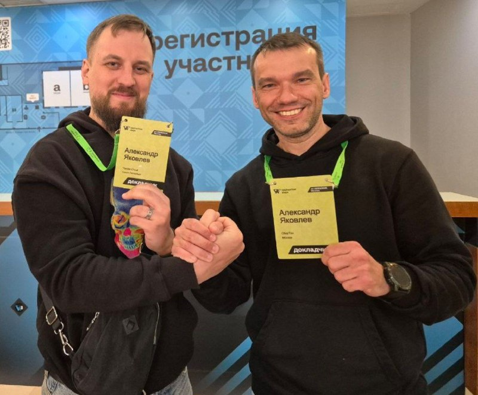
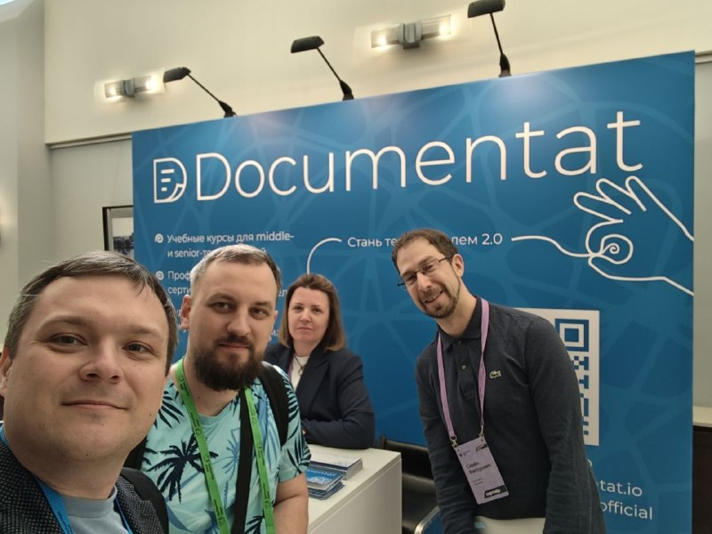
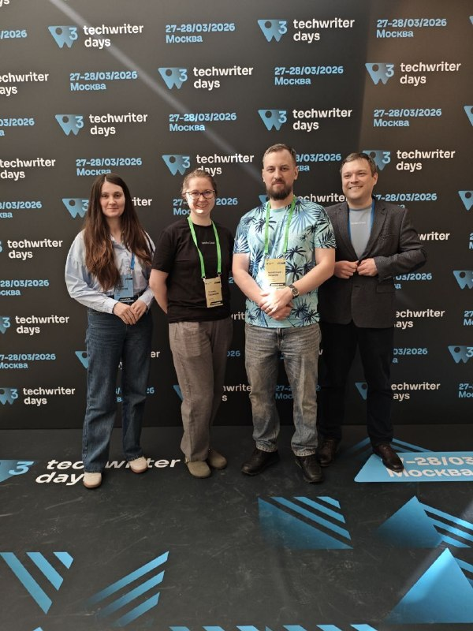
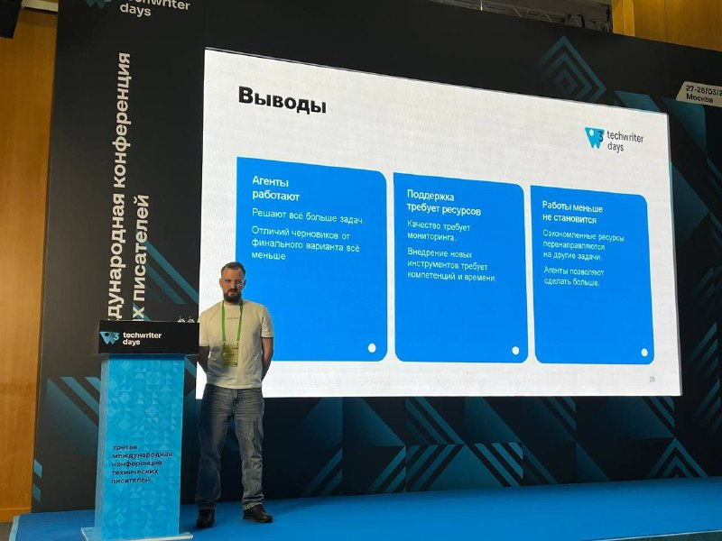

+++
title = "Выступил на TECHWRITER DAYS 3  Выступаю второй год подряд с…"
date = "2026-04-10T21:42:11+00:00"
description = "Выступил на TECHWRITER DAYS 3  Выступаю второй год подряд с докладом про одну и ту же область, конечно про ИИ. Кажется, что одно выступление в год — э"

[taxonomies]
tags = ["telegram"]

[extra]
tg_id = 135
tg_url = "https://t.me/bitswords/135"
+++

<b>Выступил на TECHWRITER DAYS 3</b>  Выступаю второй год подряд с докладом про одну и ту же область, конечно про ИИ. Кажется, что одно выступление в год — это максимум, который я могу потянуть за год. 7 месяцев внедрения агентов и параллельная подготовка доклада, дважды такое мне не под силу.   Выступать — очень круто. Наличие доклада где-то в будущем служит отличным мотиватором довести проект или исследование до конца, а попутно еще и лучше разобраться в результатах. Если отбор на конференцию суровый, то почти наверняка со сцены расскажут что-то интересное (я с огромным удовольствием слушал НЕ про ИИ). Круто и то, что можно с серьезным видом обсуждать наболевшее с людьми, которых ты сам уважаешь, а в процессе осушить с десяток фужеров для повышения градуса дискуссии. Можно знакомиться с новыми людьми и делиться тем, что не удалось рассказать со сцены. Ну и, конечно, конференция почти всегда оформляется как командировка, то есть выгоды вообще со всех сторон.  Короче, всем рекомендую выступать.

