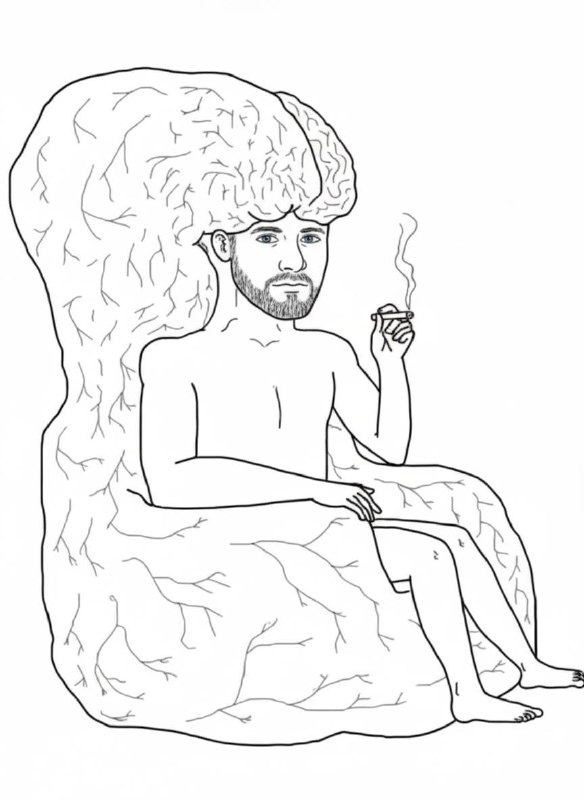

+++
title = "В последний момент отказался от идеи попросить сопроводить…"
date = "2026-07-02T13:30:55+00:00"
description = "В последний момент отказался от идеи попросить сопроводить анонс моим фото в таком виде. Но в общем и целом знайте, что гость эфира видит себя как-то "

[taxonomies]
tags = ["telegram"]

[extra]
tg_id = 146
tg_url = "https://t.me/bitswords/146"
+++

В последний момент отказался от идеи попросить сопроводить анонс моим фото в таком виде. Но в общем и целом знайте, что гость эфира видит себя как-то так, разговаривая на тему неизбежного будущего.  Постараюсь понабрасывать как следует и не забыть сказать что-то полезное.

